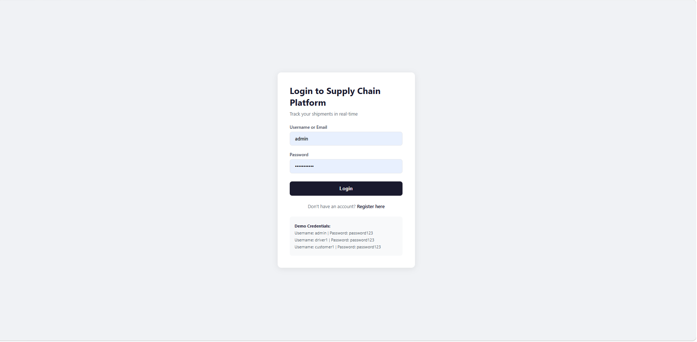
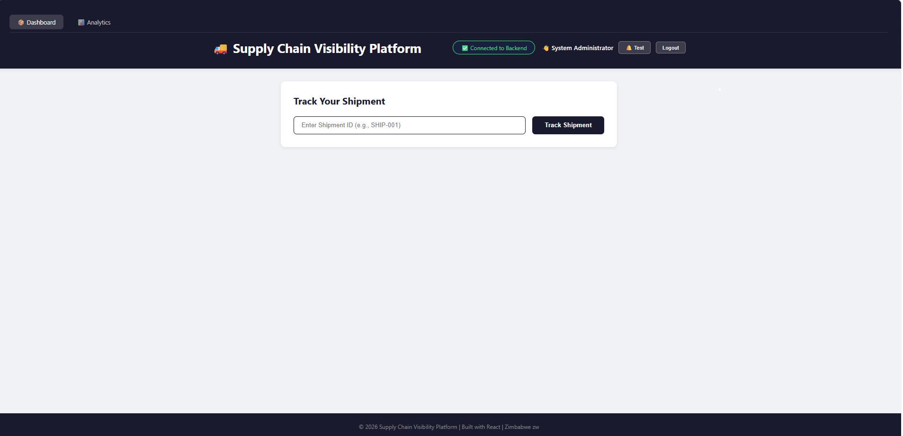
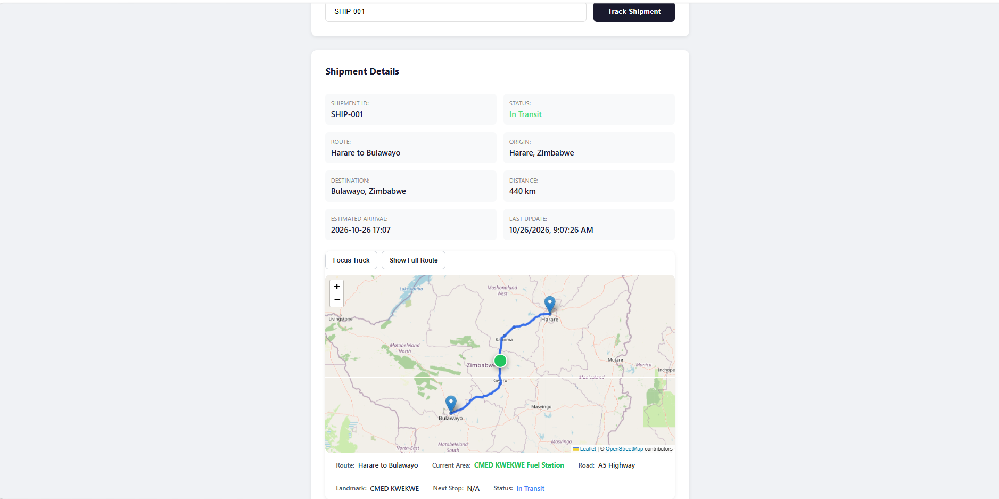
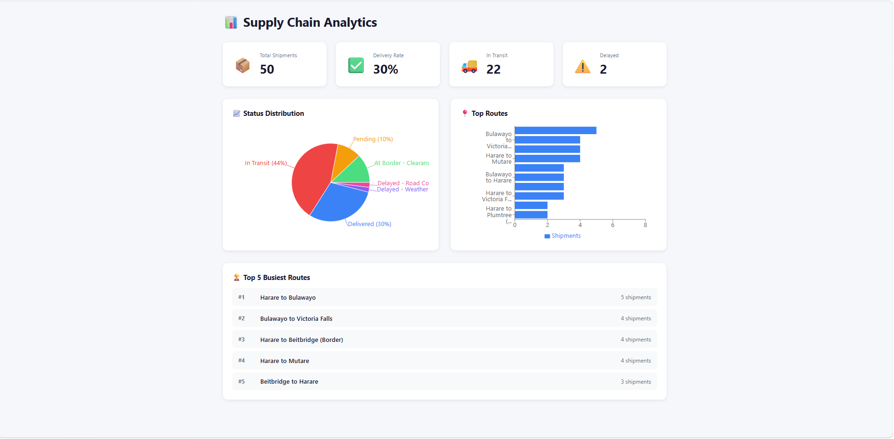
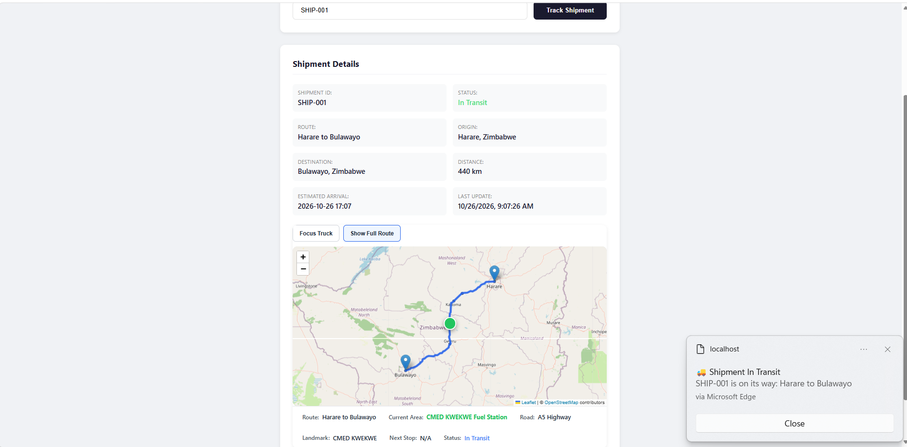

# 🚛 Supply Chain Visibility Platform --- Zimbabwe


A full-stack shipment visibility application demonstrating shipment
lookup, route visualization, shipment-status analytics, and browser
notifications for a Zimbabwe-focused logistics use case.

> **Project status:** Runs locally. A public demo has not been
> published. Shipment records are seeded application data; do not
> interpret the map as a live GPS feed unless a live tracking source has
> been integrated and verified.

------------------------------------------------------------------------

## 📋 Table of Contents

-   [Overview](#-overview)
-   [Business Problem](#-business-problem)
-   [Dataset and Scope](#-dataset-and-scope)
-   [Technology Stack](#-technology-stack)
-   [Project Structure](#-project-structure)
-   [Implemented Features](#-implemented-features)
-   [Dashboard Screenshots](#-dashboard-screenshots)
-   [Installation and Usage](#-installation-and-usage)
-   [Configuration](#-configuration)
-   [API and Verification](#-api-and-verification)
-   [Recommendations](#-recommendations)
-   [Skills Demonstrated](#-skills-demonstrated)
-   [Author](#-author)
-   [License](#-license)
-   [Acknowledgements](#-acknowledgements)

------------------------------------------------------------------------

## 🌍 Overview

The **Supply Chain Visibility Platform** is a full-stack web application
built around shipment tracking and logistics visibility for Zimbabwean
routes. It provides shipment lookup, an interactive map, a shipment
analytics dashboard, and browser notifications.

The project demonstrates how a logistics application can bring shipment
records and operational indicators into one interface. Its current
records are seeded/demo data; live GPS ingestion and production
deployment are not claimed as completed capabilities.

## 📋 Business Problem

Logistics operators and customers can face challenges such as:

-   Limited visibility into shipment status.
-   Delays at border crossings and on intercity routes.
-   Fragmented shipment information.
-   Late communication when shipment status changes.
-   Limited consolidated reporting on shipment activity.

This prototype addresses these needs through shipment search, map-based
route context, status summaries, and an analytics view.

## 📊 Dataset and Scope

The application has been tested with **50 shipment records** covering
routes associated with Zimbabwean cities and border points.

Shipment records can include:

-   Shipment identifier.
-   Origin and destination.
-   Route and location information used for map display.
-   Estimated arrival information.
-   Shipment status, such as In Transit, Delivered, Delayed, Pending, or
    At Border.

**Data limitation:** The presence of coordinates or a current-location
marker does not by itself mean that live vehicle GPS data is being
received. The current dataset should be treated as application/demo data
unless a live feed is explicitly configured.

## 🛠 Technology Stack

### Frontend

  Technology                  Purpose
  --------------------------- ---------------------------------
  React                       User interface
  React Router                Page navigation
  Leaflet and React-Leaflet   Interactive maps
  Recharts                    Analytics charts
  Axios                       HTTP requests
  Socket.IO client            Real-time communication support

### Backend

  Technology             Purpose
  ---------------------- ------------------------------------
  Node.js                JavaScript runtime
  Express                REST API
  MongoDB and Mongoose   Shipment persistence
  Socket.IO              WebSocket communication
  JSON Web Token (JWT)   Authentication support
  bcryptjs               Password hashing
  CORS                   Cross-origin request configuration

The technologies listed above describe the project stack; individual
production-readiness features, such as live GPS ingestion and deployed
infrastructure, should be treated as future work unless separately
configured.

## 📁 Project Structure

``` text
03_supply_chain_visibility_platform/
├── backend/
│   ├── scripts/
│   │   └── seedData.js
│   ├── src/
│   │   ├── models/
│   │   └── routes/
│   ├── server.js
│   └── package.json
├── frontend/
│   ├── public/
│   ├── src/
│   │   ├── components/
│   │   ├── context/
│   │   ├── data/
│   │   ├── pages/
│   │   └── utils/
│   └── package.json
├── screenshots/
├── docs/
├── tests/
└── README.md
```

This is a high-level overview; filenames may vary as the project
evolves.

## ✅ Implemented Features

-   Shipment lookup by shipment ID.
-   Shipment details and route map.
-   Shipment records served by the backend API.
-   Analytics for shipment volume, status distribution, delivery rate,
    and routes.
-   Browser notification functionality where browser permissions allow
    it.
-   MongoDB-backed shipment records.
-   API handling for unknown shipment IDs.

The frontend has compiled successfully, and the local API has previously
been verified to return 50 shipment records. Analytics figures can
change when the underlying dataset changes, so use the running
application as the source of truth for current metrics.

## 📸 Dashboard Screenshots

### Login Page



### Main Dashboard



### Shipment Details and Map



### Analytics Dashboard



### Browser Notification



> Confirm that each image exists in the `screenshots/` directory before
> publishing. The shipment-details image reference uses
> `shipment_details.png` (underscore).

## 🚀 Installation and Usage

### Prerequisites

-   Node.js 18 or later.
-   npm.
-   Git.
-   Access to a MongoDB database, either local or hosted.

### 1. Clone the repository

``` bash
git clone https://github.com/SimbarasheChindanga/supply-chain-visibility-platform.git
cd supply-chain-visibility-platform
```

### 2. Configure and start the backend

``` bash
cd backend
npm install
```

Create `backend/.env` using the configuration keys expected by the
backend:

``` env
MONGODB_URI=your_mongodb_connection_string
PORT=5000
FRONTEND_URL=http://localhost:3000
```

Replace the MongoDB placeholder with your own connection string. Keep
real credentials in `.env`; do not commit secrets.

Start the backend using the script defined in `backend/package.json`
(for this project, the development command has been `npm run dev`):

``` bash
npm run dev
```

The API is expected at `http://localhost:5000` when `PORT=5000`.

### 3. Configure and start the frontend

Open a second terminal at the repository root:

``` bash
cd frontend
npm install
```

If needed, configure the frontend API base URL in `frontend/.env`:

``` env
REACT_APP_API_URL=http://localhost:5000
```

Then start the frontend:

``` bash
npm start
```

The frontend normally opens at `http://localhost:3000`. If port 3000 is
already in use, the development server may offer another port; use the
URL it prints.

### 4. Try shipment tracking

Use a shipment ID that exists in the database, such as `SHIP-001`. An
unknown ID such as `SHIP-999` should produce a not-found response.

### 5. View analytics

Open the Analytics page to see summaries calculated from the current
shipment records. Metrics may differ from screenshots or earlier runs if
the dataset has changed.

## ⚙️ Configuration

  -----------------------------------------------------------------------------------------------------
  Variable                Purpose                 Example
  ----------------------- ----------------------- -----------------------------------------------------
  `MONGODB_URI`           MongoDB connection      `mongodb://127.0.0.1:27017/supply_chain_visibility`
                          string                  

  `PORT`                  Backend port            `5000`

  `FRONTEND_URL`          Allowed frontend origin `http://localhost:3000`
                          for CORS                

  `REACT_APP_API_URL`     Frontend API base URL   `http://localhost:5000`
  -----------------------------------------------------------------------------------------------------

Use environment-specific values for deployment. Do not publish database
passwords, JWT secrets, or other credentials in this README or in source
control.

## 🔎 API and Verification

The local API was previously checked for the following behaviours:

-   The shipment endpoint returned 50 records.
-   A known shipment ID (`SHIP-001`) returned a shipment.
-   An unknown shipment ID (`SHIP-999`) returned a not-found response.
-   The frontend production build completed successfully.

These checks describe the previously tested local version, not a
guarantee that a remote deployment is currently available.

## 💡 Recommendations

### 1. Data quality and database reliability

-   Validate shipment fields and status values.
-   Add indexes for frequently queried fields such as shipment ID.
-   Add database backup and recovery procedures.
-   Improve structured logging and operational error reporting.

### 2. Live tracking integration

-   Integrate a verified GPS or telematics data source.
-   Timestamp and validate incoming location updates.
-   Display the age of the last location update so stale data is
    visible.

### 3. Border and delay intelligence

-   Record border arrival, clearance, and departure timestamps.
-   Measure dwell time at border crossings.
-   Compare estimated and actual arrival times when actual delivery data
    is available.

### 4. Notifications

-   Add configurable email or SMS notifications.
-   Let users choose which shipment events trigger alerts.
-   Record notification delivery outcomes.

### 5. Analytics

-   Add on-time delivery and delay-duration measures when reliable
    timestamps are available.
-   Compare route performance over time.
-   Add cost analysis and predictive ETA only when suitable historical
    data is available.

### 6. Security and deployment

-   Verify authentication and authorization flows.
-   Keep secrets in environment variables or a secrets manager.
-   Deploy the frontend and backend, configure production CORS, and
    document the public URL only after verifying the deployment.
-   Add automated tests and CI checks.

## 🏆 Skills Demonstrated

  Skill Category            Skills
  ------------------------- ------------------------------------------------------
  Frontend                  React, component-based UI, routing, state management
  Backend                   Node.js, Express, REST API development
  Data and persistence      MongoDB, Mongoose, seeded datasets
  Data visualization        Recharts, shipment-status and route analytics
  Mapping                   Leaflet, route and location visualization
  Security                  JWT concepts, password hashing, CORS configuration
  Real-time communication   Socket.IO/WebSocket integration
  Project delivery          Git, GitHub, documentation, testing and debugging

## Author

**Simbarashe Chindanga**

-   **Role:** Aspiring Transport Technology Specialist
-   **Focus:** Supply Chain Visibility, Data Analytics, and Full-Stack
    Development
-   **Location:** Zimbabwe
-   **GitHub:**
    [SimbarasheChindanga](https://github.com/SimbarasheChindanga)
-   **Email:** <chindangasimbarashe02@gmail.com>

## 📄 License

This project is licensed under the MIT License. See the
[LICENSE](LICENSE) file for details.

## 🙏 Acknowledgements

-   [OpenStreetMap](https://www.openstreetmap.org/) for map data and
    tiles.
-   [Leaflet](https://leafletjs.com/) for interactive mapping.
-   [Recharts](https://recharts.org/) for data visualization.
-   [MongoDB](https://www.mongodb.com/) for database technology.
